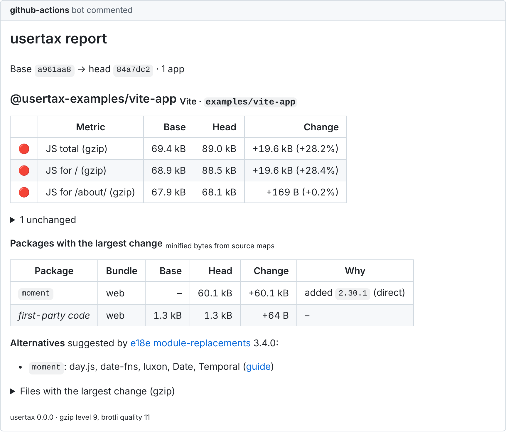

<div align="center">

# usertax

**What does this pull request cost your users?**<br>
Web and mobile · Explains _why_ · No API keys

[](https://github.com/marketplace/actions/usertax-pr-performance-cost)
[](https://www.npmjs.com/package/@usertax/cli)
[](https://github.com/omerozkilic/usertax/actions/workflows/ci.yml)
[](https://github.com/omerozkilic/usertax/actions/workflows/codeql.yml)
[](package.json)
[](tsconfig.base.json)
[](LICENSE)

[Türkçe README](README.tr.md) · [Metrics & budgets](docs/metrics.md) · [GitHub Action](docs/github-action.md) · [MCP server](docs/mcp.md) · [Architecture decisions](docs/adr/README.md) · [Demo](docs/demo/README.md)

</div>

---

usertax measures what a pull request costs the people who use your app — JavaScript shipped per
route, Lighthouse lab metrics, React Native bundles and APK / AAB / IPA size — and answers the
question reviewers actually ask: **why did it change?** It joins the lockfile diff of the PR with
source-map sizes, so a comment says _"`moment` was added and brought 60 kB"_ instead of _"the
bundle grew"_.

It is deterministic: **no LLM, no API key, no account, no upload.** The same build gives the
same report.

**Get it:** the GitHub Action [`omerozkilic/usertax-action@v0`](https://github.com/marketplace/actions/usertax-pr-performance-cost) on the Marketplace ·
the CLI and MCP server [`npx @usertax/cli`](https://www.npmjs.com/package/@usertax/cli). usertax is
at 0.x: the report schema and the action inputs may still change between minor versions
([changelog](CHANGELOG.md)).

## What it looks like

A real pull request against [`examples/vite-app`](examples/vite-app) that adds `moment` to show
a date, measured on real builds ([full comment](docs/demo/add-moment.md),
[how to reproduce](docs/demo/README.md)):

<picture>
  <source media="(prefers-color-scheme: dark)" srcset="docs/assets/comment-add-moment-dark.png">
  
</picture>

<sub>Rendered from the Markdown usertax posted, with GitHub's stylesheet
([`scripts/render-comment.js`](scripts/render-comment.js)).</sub>

## Why usertax?

- **Explains the change.** Lockfile diffs (pnpm, npm, Yarn 1, Yarn 2+ and Bun) are joined with
  byte-exact source-map attribution: added, upgraded, or "same version, more of it imported" —
  including transitive packages and the dependency that pulled them in
  ([ADR 0008](docs/adr/0008-attribution-lockfile-and-source-maps.md)).
- **Honest numbers.** Every byte of every JavaScript file is attributed to a package, to your
  code, or explicitly to "unattributed", and the three add up to the file size. Lighthouse
  changes are judged against measured noise, never guessed
  ([ADR 0007](docs/adr/0007-lighthouse-noise-model.md)).
- **Sourced suggestions only.** Alternatives come from the curated, MIT-licensed
  [e18e module-replacements](https://github.com/e18e/module-replacements) dataset, with a link
  to its guide. Nothing is generated.
- **Web and mobile in one comment.** The report format covers routes, React Native bundles and
  app archives for any number of apps, so one PR comment is designed to cover a whole monorepo
  ([ADR 0003](docs/adr/0003-report-schema-as-public-contract.md)).
- **Safe for fork PRs by design.** Measure in `pull_request`, comment from `workflow_run`;
  reports from PRs are validated and escaped as untrusted input
  ([ADR 0005](docs/adr/0005-fork-safe-two-workflow-pattern.md)).
- **Fast.** Base reports are stored once per push to the default branch and reused by every PR
  ([ADR 0004](docs/adr/0004-base-reports-from-artifacts.md)).

## Status

| Area         | Today                                                                                                                                                                                                                              | Planned                       |
| ------------ | ---------------------------------------------------------------------------------------------------------------------------------------------------------------------------------------------------------------------------------- | ----------------------------- |
| Web bundles  | Vite, React Router 7, Astro, SvelteKit, Nuxt and Next.js 16 with Turbopack or webpack (routes), webpack and static output (files)                                                                                                  | –                             |
| Attribution  | Source maps, lockfiles: pnpm 6 / 9, npm 2 / 3, Yarn 1, Yarn 2+, Bun                                                                                                                                                                | –                             |
| Budgets      | `max`, `min`, increase / decrease in bytes or percent, warn / fail, from `usertax.config.(json\|ts)`; exit code 1 on failure                                                                                                       | –                             |
| Lighthouse   | Runner (`--lighthouse`), every run stored, medians, IQR, noise thresholds calibrated on GitHub-hosted runners ([benchmarks](docs/benchmarks/README.md))                                                                            | –                             |
| Mobile       | Expo and bare React Native bundles (JS and Hermes bytecode, with attribution), APK / AAB / IPA breakdown                                                                                                                           | Per-device download estimates |
| Distribution | GitHub Action on the [Marketplace](https://github.com/marketplace/actions/usertax-pr-performance-cost) (fork-safe two-workflow setup, dogfooded here); CLI `npx @usertax/cli`; MCP server (`usertax mcp`); monorepos in one report | –                             |

## GitHub Action

Two workflows: one measures the pull request with a read-only token, the other posts the comment
from your default branch, so pull requests from forks are safe
([setup and inputs](docs/github-action.md)). This repository runs the action on its own pull
requests. The [Marketplace page](https://github.com/marketplace/actions/usertax-pr-performance-cost) has both workflows
ready to copy, and a one-workflow setup for private repositories.

Or let usertax write them: in your repository, run

```bash
npx @usertax/cli init
```

It detects the package manager, the build script and the apps, writes both workflows
(`--single` for one), and says what each app's build needs (source maps, for example).
`--budget` adds a starter `usertax.config.json`.

## Quickstart (CLI)

```bash
# Measure an app you have already built (Vite: build.sourcemap = 'hidden', build.manifest = true)
npx @usertax/cli measure path/to/app --output base.json
# …make your change, rebuild…
npx @usertax/cli measure path/to/app --output head.json

npx @usertax/cli diff head.json --base base.json          # Markdown
npx @usertax/cli diff head.json --base base.json -f json  # JSON
```

Installed as a dev dependency (`npm i -D @usertax/cli`), the command is `usertax`. Node.js 22.23.4, 24.22.1 or
26.12.1 or later (the releases that fix CVE-2026-111497); `lighthouse` and `chrome-launcher` are optional, for `--lighthouse`.

`usertax measure` reads the build output, the source maps and the nearest lockfile. It never
builds your app and never needs network access.

## MCP server

`usertax mcp` lets coding agents measure a change and explain its cost with usertax's numbers:
tools `measure`, `compare`, `explain_package` and `alternatives`, over stdio, with no network
and no LLM inside ([setup](docs/mcp.md)).

## How it works

```text
 build output ─┐
 source maps ──┼─▶ usertax measure ─▶ report.json ─┐
 lockfile ─────┘   (@usertax/measure)              ├─▶ usertax diff ─▶ PR comment · job summary · JSON
                                     base report ──┘   (@usertax/core: diff, attribution,
                                                        budgets, noise model, rendering)
```

- [`@usertax/core`](packages/core): pure functions. Report schema, diff, attribution, budgets,
  Markdown and JSON rendering. No file system, no network.
- [`@usertax/measure`](packages/measure): collectors. Output directories, source maps,
  lockfiles.
- [`@usertax/cli`](packages/cli): the command-line interface (`usertax`) and the MCP server.

Metric ids, units, budgets and the noise model are documented in
[`docs/metrics.md`](docs/metrics.md); the configuration file in
[`docs/configuration.md`](docs/configuration.md).

## Development

```bash
pnpm install
pnpm check            # typecheck, lint, format, tests with coverage
pnpm build:examples   # build the example apps
pnpm e2e              # measure the examples and check invariants
pnpm demo             # reproduce docs/demo/add-moment.md
```

See [CONTRIBUTING.md](CONTRIBUTING.md). Every number in this repository's documentation comes
from a measurement you can reproduce with these commands.

## Prior art

usertax builds on ideas from these projects. If you need one of their features today, use them:
[Lighthouse CI](https://github.com/GoogleChrome/lighthouse-ci),
[treosh/lighthouse-ci-action](https://github.com/treosh/lighthouse-ci-action),
[size-limit](https://github.com/ai/size-limit),
[compressed-size-action](https://github.com/preactjs/compressed-size-action),
[BundleMon](https://github.com/LironEr/bundlemon),
[RelativeCI bundle-stats](https://github.com/relative-ci/bundle-stats),
[rn-size-check](https://github.com/MuhammadHamza47/rn-size-check),
[app-size-report](https://github.com/appshipkit/app-size-report),
[react-native-agents `size`](https://github.com/maheshwarimrinal/react-native-agents),
[Expo Atlas](https://github.com/expo/atlas) and
[react-native-bundle-visualizer](https://github.com/callstack/react-native-bundle-visualizer).
A comparison is in [`docs/research/2026-11-market-scan.md`](docs/research/2026-11-market-scan.md).

## License

[MIT](LICENSE). Alternative-package data is generated from
[e18e module-replacements](https://github.com/e18e/module-replacements) (MIT).
