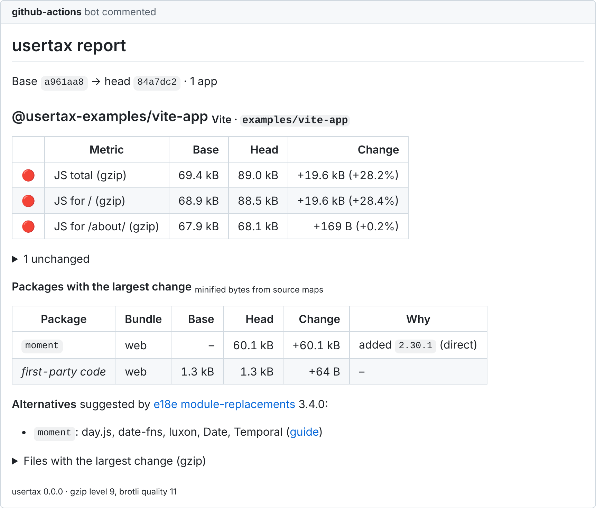

<div align="center">

# usertax

**What does this change cost your users?**

Measure the JavaScript each route ships, Lighthouse lab metrics, React Native bundles and
APK / AAB / IPA size, then compare two builds and see **which dependency caused the difference**.
From your terminal, any CI, or your coding agent. No account, no API key, no upload.

[](https://www.npmjs.com/package/@usertax/cli)
[](https://github.com/omerozkilic/usertax/blob/main/package.json)
[](https://github.com/omerozkilic/usertax/blob/main/LICENSE)

</div>

<picture>
  <source media="(prefers-color-scheme: dark)" srcset="https://raw.githubusercontent.com/omerozkilic/usertax/main/docs/assets/comment-add-moment-dark.png">
  
</picture>

<sub>Real output for adding `moment` to a small Vite app
([how it was made](https://github.com/omerozkilic/usertax/blob/main/docs/demo/README.md)).</sub>

## Try it in one minute

Build your app with source maps (Vite: `build.sourcemap: 'hidden'` and `build.manifest: true`;
Next.js: `productionBrowserSourceMaps: true`), then:

```bash
npx @usertax/cli measure apps/web -o before.json
```

Make your change and build again:

```bash
npx @usertax/cli measure apps/web -o after.json
```

```bash
npx @usertax/cli diff after.json --base before.json
```

`diff` prints the report above as Markdown (`-f json` for JSON). usertax never builds your app and
never needs network access: it reads the build output, its source maps and your lockfile.

## What it measures

| Area             | What usertax reports                                                                                                                                                                  |
| ---------------- | ------------------------------------------------------------------------------------------------------------------------------------------------------------------------------------- |
| **Web**          | Every shipped file (raw, gzip, brotli), JavaScript per route for Vite and Next.js (Turbopack and webpack), webpack and static output                                                  |
| **Lighthouse**   | Performance score, LCP, TBT, CLS: several runs per page, medians and spread, judged against measured noise                                                                            |
| **React Native** | Expo and bare React Native bundles, JavaScript or Hermes bytecode, attributed to packages                                                                                             |
| **App archives** | APK, AAB and IPA broken down into code, native libraries, resources, assets and the JS bundle                                                                                         |
| **Why**          | Lockfile diffs (pnpm, npm, Yarn 1, Yarn 2+) joined with source-map attribution: added, upgraded, or "same version, more of it imported", with the dependency that pulled a package in |
| **Alternatives** | Lighter or native replacements from the curated [e18e module-replacements](https://github.com/e18e/module-replacements) dataset, never generated                                      |

Every byte of a JavaScript file is attributed to a package, to your code or explicitly to
"unattributed", and the three add up to the file size.

## Examples

```bash
# Measure every app of a monorepo (pnpm, npm or Yarn workspaces)
npx @usertax/cli measure -o report.json

# Lighthouse: 5 recorded runs of two pages (needs lighthouse and chrome-launcher installed)
npx @usertax/cli measure apps/web --lighthouse / --lighthouse /pricing -o report.json

# Expo: finds the bundles of `npx expo export --source-maps` in dist/
# (export one platform at a time: --platform all is not byte-for-byte reproducible)
npx @usertax/cli measure apps/mobile -o report.json

# Bare React Native: your bundles (with .map files) and a release archive
npx @usertax/cli measure apps/bare \
  --bundle android=apps/bare/dist/index.android.bundle \
  --bundle ios=apps/bare/dist/main.jsbundle \
  --archive apps/bare/android/app/build/outputs/apk/release/app-release.apk

# Fail a CI job when a budget is exceeded (exit code 1)
npx @usertax/cli diff head.json --base base.json --config usertax.config.json
```

## Budgets

Put limits in `usertax.config.json` at the repository root; `usertax diff` exits with code 1
when a `fail` budget is exceeded, on any CI:

```json
{
  "$schema": "./node_modules/@usertax/cli/schema/config.schema.json",
  "budgets": [
    { "metric": "route[*].js.gzip", "maxIncrease": "10 kB" },
    { "metric": "archive[*].file", "maxIncreasePercent": 2, "level": "warn" }
  ]
}
```

## For coding agents (MCP)

`usertax mcp` is a [Model Context Protocol](https://modelcontextprotocol.io) server, so an agent
can measure a change instead of guessing its cost. Tools: `measure`, `compare`, `explain_package`
and `alternatives`. With Claude Code:

```bash
claude mcp add usertax -- npx -y @usertax/cli mcp
```

## On every pull request

The [GitHub Action](https://github.com/omerozkilic/usertax-action) runs the
same measurement on each pull request and posts the report as one comment, with a `usertax` check
for the budgets, in a setup that is safe for pull requests from forks.

## Reference

| Command                               | Purpose                                                                    |
| ------------------------------------- | -------------------------------------------------------------------------- |
| `usertax measure [app-dir]`           | Measure built apps and write a report (JSON). `--help` lists every option. |
| `usertax diff <head> [--base <base>]` | Compare two reports: Markdown or JSON, with budgets.                       |
| `usertax mcp`                         | Start the MCP server on standard input and output.                         |

Exit codes: `0` success, `1` a budget failed, `2` invalid usage or input, `3` internal error.
Requires Node.js 22.18 or later. `lighthouse` and `chrome-launcher` are optional peer
dependencies, needed only for `--lighthouse`.

## Links

[Documentation](https://github.com/omerozkilic/usertax#readme) ·
[Metrics and budgets](https://github.com/omerozkilic/usertax/blob/main/docs/metrics.md) ·
[Configuration](https://github.com/omerozkilic/usertax/blob/main/docs/configuration.md) ·
[MCP server](https://github.com/omerozkilic/usertax/blob/main/docs/mcp.md) ·
[Benchmarks](https://github.com/omerozkilic/usertax/blob/main/docs/benchmarks/README.md) ·
[Changelog](https://github.com/omerozkilic/usertax/blob/main/CHANGELOG.md) ·
[Issues](https://github.com/omerozkilic/usertax/issues)

[MIT](https://github.com/omerozkilic/usertax/blob/main/LICENSE) © Omer Ozkilic
